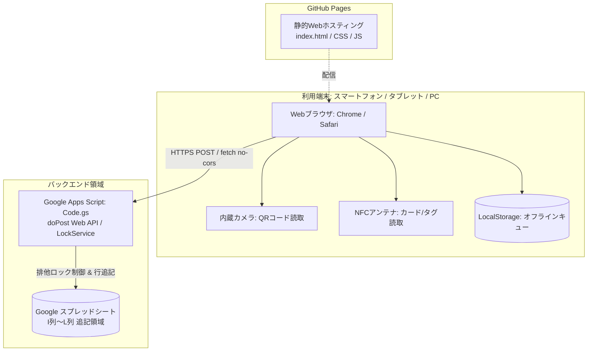

# システム仕様書：QR・NFC ハイブリッドスキャナー (multiScanner_v02)

本書は、「QR・NFC ハイブリッドスキャナー (multiScanner_v02)」のシステム仕様、設計、データ構造、および機能詳細を定義する公式仕様書です。

---

## 1. システム概要

### 1.1 システム名
- **システム名称**: multiScanner_v02（QR・NFC ハイブリッドスキャナー Webホスティング＋GAS連携版）
- **バージョン**: 2.0.0

### 1.2 開発背景と目的
本システムは、学校や放課後子ども教室等の現場において、QRコードおよびNFCカードを用いた各種データ（児童ID、活動記録等）を迅速かつ確実に収集し、Googleスプレッドシートへ自動記録するためのハイブリッドスキャンシステムです。  

現バージョン（v02）の開発初期においては、Google Apps Script (GAS) 内に完全統合してWebアプリとして運用することを目指しました。しかし、GASのiframe環境におけるブラウザのセキュリティ制限（Permissions Policy）に起因する**カメラ起動問題**に直面したため、カメラが制約を受けずにスムーズに常時稼働できる **「GitHub Pages（Webホスティング）」にスキャナー画面（フロントエンド）をデプロイし、バックエンドのGoogle Apps Script（`doPost` API）と非同期連携する構成** を採用しました。  

これにより、現場端末でのスムーズなカメラ起動・連続スキャンを実現しながら、既存の名簿データ（A〜H列）を壊さずにI列以降へスマート追記できる高い実用性と可用性を確立しました。

### 1.3 主要な設計方針
1. **GitHub Pagesによる安定したカメラ稼働（Permissions Policy制約の回避）**  
   Googleのiframeサンドボックスによるカメラ権限遮断を受けない独立Web環境（GitHub Pages）でフロントエンドを運用。カメラ映像ストリームがスムーズに常時稼働します。
2. **GAS Web API（doPost）によるスプレッドシート自動連携**  
   スキャンデータをGoogle Apps ScriptのWebアプリエンドポイントへ非同期POST送信。スプレッドシートの指定列（I〜L列）へリアルタイムに自動追記されます。
3. **既存データ共存型のスマート書き込み**  
   A列〜H列に児童・職員名簿や関数が既に配置されているシートでも、I列の空き状況を自動検知して末尾へ順番に追記します。
4. **排他制御（LockService）による同時書き込み保護**  
   複数端末からの同時スキャン時も、GAS側の `LockService` により行の重複・上書き事故を完全に防止します（最大10秒待機）。
5. **通信切断・電波不良時のデータ保全（ローカルキュー＆再送機構）**  
   端末側のブラウザストレージ（LocalStorage）にスキャンデータを即座に蓄積し、電波が不安定な環境でもデータの紛失を防止。通信回復後にワンクリックで一括再送できます。
6. **五感による即時フィードバック**  
   読み取り成功時に「Web Audioによる電子音（ピピッ）」「端末振動（バイブレーション）」「画面カードの点滅」を同時に行い、現場での確実な読み取り実感を提供します。

---

## 2. システム構成とアーキテクチャ

### 2.1 システム構成図

### 2.2 動作環境要件

| 区分 | 動作環境・要件 | 備考 |
| :--- | :--- | :--- |
| **フロントエンド配信** | GitHub Pages（Webホスティング） | 静的HTML/CSS/JavaScriptの配信 |
| **バックエンド環境** | Google Apps Script（Webアプリ / `doPost`） | スプレッドシートと連携するWeb API |
| **データストア** | Google スプレッドシート | 1ファイルで数万件の蓄積に対応 |
| **クライアントOS** | Android 10以降 / iOS 15以降 / Windows 10/11 / macOS | 最新のOS環境を推奨 |
| **推奨ブラウザ** | **Android**: Google Chrome（最新版） **iOS / iPadOS**: Safari または Chrome **PC**: Google Chrome / Microsoft Edge | ※Web NFC機能はAndroid版Chromeでのみ動作（QRは全端末対応） |
| **通信要件** | インターネット接続（HTTPS） | オフライン時も読み取り・端末内一時保存が可能 |
| **ハードウェア要件** | Webカメラ（内カメラまたは外カメラ）、NFCリーダー（カード読取時のみ） | |

### 2.3 使用技術・外部ライブラリ

| 区分 | 技術・ライブラリ名 | バージョン/仕様 | 用途 |
| :--- | :--- | :--- | :--- |
| **ホスティング環境** | GitHub Pages | - | スキャナーUI（フロントエンド）の配信 |
| **フロントエンド言語** | HTML5 / CSS3 / JavaScript (ES6+) | Vanilla (フレームワーク非依存) | 画面描画、操作制御、通信制御 |
| **デザインシステム** | カスタムモダンUI（ダークテーマ） | モバイルファースト・レスポンシブ | 現場での視認性と操作性の向上 |
| **QRコード解析** | html5-qrcode | v2.3.8 (CDN) | カメラ映像からの高速QRコード検出 |
| **NFC読み取り** | Web NFC API (`NDEFReader`) | W3C Standard Draft | FeliCa / MIFARE等のNDEFテキスト・UID読み取り |
| **サウンド生成** | Web Audio API | ブラウザ標準API | 音声ファイル不要の2和音（880Hz→1760Hz）電子音生成 |
| **バックエンド言語** | Google Apps Script (V8 Runtime) | ES6準拠 | Web API (`doPost`) 提供、スプレッドシート書き込み、排他制御 |

---

## 3. データ仕様（スプレッドシート設計）

### 3.1 シート構造
本システムは、名簿データ（A〜H列）とスキャン記録データ（I〜L列）を同一シート内で独立して管理できる設計となっています。

| 列番号 | 列記号 | 項目名 | データ型 | 格納例 | 説明 |
| :---: | :---: | :--- | :--- | :--- | :--- |
| 1〜8 | **A〜H列** | （名簿・マスタ領域） | 任意 | 児童番号、氏名、クラス等 | システム側からは**読み書き・変更を一切行いません** |
| 9 | **I列** | `Timestamp` | 日時文字列 | `2026/09/15 10:30:15` | スキャンが行われた日時（日本時間・秒単位） |
| 10 | **J列** | `QR/NFC Text` | 文字列 | `R8_1101` または `https://...` | 読み取ったQRコード本文、またはNFCテキストデータ |
| 11 | **K列** | `種別` | 文字列 | `QR` または `NFC` (テスト時は `TEST`) | スキャンを行った入力デバイス種別 |
| 12 | **L列** | `NFC固有ID` | 文字列 | `04:A2:3B:4C:5D:6E:7F` | NFCタグの固有UID（シリアル番号）。QR時は空欄 |

> [!NOTE]
> **対象シートの指定**:
> `Code.gs` 内の定数 `TARGET_SHEET_NAME` が空欄（`""`）の場合は、スプレッドシートの一番左にあるアクティブシートに書き込みます。シート名を指定した場合は、該当名称のシートにのみ書き込みを行います。

### 3.2 スマート空行検知アルゴリズム
A〜H列に数千行の名簿データが存在していても、スキャン記録領域（I列〜L列）を正しく順番に追記するための独自ロジックを搭載しています。

1. 対象シートの最大行数（`maxRows`）を取得。
2. I列のデータ配列を最下行から上方向へスキャン。
3. 最初に値（文字列・数値・日付）が存在した行（`r`）を特定。
4. `targetRow = r + 2`（次の空行）を開始位置として決定。
5. 1行も記録がない場合は、ヘッダー行を考慮して `2行目` から書き込み開始。
6. `targetRow` がシートの `maxRows` を超える場合は、自動的に `insertRowAfter` で行を拡張。

---

## 4. 機能仕様詳細

### 4.1 画面機能一覧

| 画面要素 | 機能名 | 詳細仕様 |
| :--- | :--- | :--- |
| **ヘッダー** | アプリタイトル・バッジ | 接続状態バッジ（「連携中」「URL未設定」「GAS直結」）および設定ボタンを表示。 |
| **カウンターバー** | リアルタイム件数表示 | **送信待機（保留件数）** と **スプレッドシート記録済件数** を常時集計・表示。 |
| **モード切替タブ** | QR / NFC 切替 | ワンタップでスキャンモードを切り替え。切り替え時に不要なカメラやNFC待受を自動停止して消費電力を節約。 |
| **QRスキャナービュー** | カメラプレビュー＆ガイド | 中央に緑色のアライメントガイド枠とレーザー走査アニメーションを表示。 |
| **QRカメラ操作** | カメラ反転・一時停止 | 「外カメラ / 内カメラ」の切り替え、および「一時停止 / 再開」ボタンを提供。 |
| **カメラ障害通知** | エラーオーバーレイ | 権限拒否、使用中、デバイス未検出等の理由を自動判別し、現場向けの対処手順（権限確認方法等）を案内。 |
| **NFCリーダービュー** | レーダー待受アニメーション | パルス状に波紋が広がるアニメーションで待受状態を視覚化。 |
| **最新読取結果カード** | 直前スキャン結果の即時表示 | 読み取った文字列、NFC UID、読み取り時刻、GAS同期結果をハイライト表示。 |
| **スキャン履歴一覧** | 直近10件のタイムライン表示 | 最新10件の履歴をカード形式で表示。成功マーク（✅）や失敗マーク（❌）を表示。 |
| **エラー再送ボタン** | 個別再送 / 一括再送 | 送信失敗時、履歴行の「❌ 再送」または上部の「🔄 未送信を再送」からワンタップで再送。 |
| **設定モーダル** | URL設定・音・振動・テスト | GAS WebアプリURLの登録・自動保存、電子音/振動のON/OFF（LocalStorage永続化）、およびインライン結果表示付きテスト書き込み実行。 |

---

### 4.2 コアロジック仕様

#### ① QRコード読み取り仕様
- **解像度・走査速度**: 15 FPS（フレーム/秒）、スキャン枠サイズ 220px × 220px。
- **カメラ制御**: デフォルトで背面カメラ（`facingMode: "environment"`）を起動。前面カメラ（`facingMode: "user"`）への切り替え、およびカメラデバイスのフォールバック探索ロジックを搭載。
- **二重読み取り防止（デバウンス処理）**:  
  直前に読み取った「種別 + テキスト + UID」と一致する場合、スキャン成功から **2,500ミリ秒（2.5秒間）** は同一コードを無視。

#### ② NFC読み取り仕様
- **対応規格**: Web NFC API（NDEF仕様）。
- **データ抽出**:
  - メッセージ内に含まれる `recordType === 'text'` のレコードをUTF-8デコードして取得。
  - NFCタグの固有シリアル番号（`event.serialNumber`）をUIDとして抽出。
- **非対応環境のハンドリング**: iOSやPCなどWeb NFC非対応環境で開いた場合、案内メッセージ（「⚠️ このブラウザはWeb NFCに未対応です。Android版Chromeでお試しください」）を表示し、アプリのクラッシュを防止。

#### ③ 五感フィードバック仕様
スキャン成功時に以下のフィードバックが即座に実行されます：
1. **電子音**: Web Audio APIを使用し、外部音源ファイルのダウンロードなしで再生。
   - 第1音: 880Hz（ラ音）、長さ0.1秒
   - 第2音: 1760Hz（1オクターブ上のラ音）、長さ0.15秒（ピピッという軽快な確定音）
2. **バイブレーション**: `navigator.vibrate([100, 50, 100])`（100ms振動 → 50ms休止 → 100ms振動）。
3. **視覚効果**: 結果表示カードに青白いグロー発光アニメーション（`success-flash`）を適用。

#### ④ オフラインキュー＆非同期データ送信仕様
1. スキャンが成功した瞬間、一意なID（`scan_タイムスタンプ_乱数`）を付与したレコードオブジェクトを生成。
2. 端末の `localStorage`（キー: `multi_scan_queue_v02`）に最大50件まで即座に保存。
3. **バックエンド（GAS）への非同期通信**:
   - **外部ホスティング時（標準運用）**: `fetch(gasUrl, { method: 'POST', mode: 'no-cors', body: JSON.stringify(...) })` をバックグラウンドで即座に実行。
   - **GAS内部実行時（フォールバック）**: `google.script.run.saveScanData()` を非同期実行。
   - **送信成功時**: `status = 'synced'` に更新し、累計記録数をインクリメント。
   - **通信失敗時**: `status = 'error'` としてキューに残し、画面上に「❌ 未送信を再送」ボタンを表示。
4. 電波復帰後、未送信データのみを抽出して順番にスプレッドシートへ再送可能。

#### ⑤ サーバー側排他制御仕様（同時アクセス対策）
複数端末（例: 正門と東門の2台のスマホ）から同時にスキャンデータが送信された際、同じ行に上書きされる競合事故を防止するため、GASの排他ロックを実装しています。
- **ロック機構**: `LockService.getScriptLock()`
- **最大待機時間**: 10,000ミリ秒（10秒間）
- **処理フロー**: ロック取得 → I列最終行判定 → I〜L列へ一括書き込み（`setValues`） → ロック解放（`finally`節で確実に解除）

---

## 5. セキュリティ・プライバシー仕様

### 5.1 認証およびアクセス制御
- **WebホスティングとGASのエンドポイント保護**:  
  GitHub Pages上の静的フロントエンドから、GAS Webアプリの公開エンドポイント（`doPost`）へセキュアにPOST通信を実施。
- **入力値の検証**:  
  バックエンド（`Code.gs`）側で受信したJSONデータの形式チェックおよび必須項目のバリデーションを厳格に実施。

### 5.2 プライバシー・バイ・デザイン
- **個人情報の非保持**:  
  本アプリ自体には、氏名・住所・生年月日などの個人情報マスタを保持していません。QRやNFCに格納されたコード（例: 児童ID `R8_1101`）のみを取り扱い、マスタとの紐付けはスプレッドシート側の関数（`XLOOKUP` / `VLOOKUP`）で行う構造とすることで、漏洩リスクを最小化しています。
- **ソースコードの機密性**:  
  プログラム内に個人情報、組織ドメイン、秘密鍵、パスワード等をハードコードしていません。

### 5.3 XSS（クロスサイトスクリプティング）防御
読み取ったQRコード本文に悪意あるHTMLタグやJavaScript（`<script>`等）が含まれていた場合でも、履歴一覧および最新結果描画時に `escapeHtml()` 関数を通じてサニタイズ処理を実施。スクリプトの不正実行を完全に防止します。

---

## 6. 非機能要件・制約事項

### 6.1 システム制約
1. **Web NFCの対応ブラウザ制約**  
   - Web NFC APIは、現在 Google Chrome on Android のみ対応しています。
   - iOS（iPhone/iPad）のSafariおよびChromeはWeb NFC APIを公開していないため、iOS端末では **QRスキャナー機能のみ** ご利用いただけます。
2. **カメラ利用時のHTTPS要件**  
   - ブラウザのカメラアクセスセキュリティ仕様により、HTTPS環境でのみカメラが起動します（GitHub Pagesは自動で常時HTTPS対応）。
3. **Google Apps Script の実行制限**  
   - GASの仕様により、同時実行数や1日あたりのトリガー・URLフェッチ制限が存在します。一般的な受付・出席確認規模（同時数台〜十数台、1日当たり数千件程度）では制限内に収まります。

---

## 7. 改訂履歴

| バージョン | 改訂日 | 改訂内容 | 作成・承認者 |
| :---: | :---: | :--- | :--- |
| **v0.1** | 2026/09/10 | 初版作成。外部ホスティング＋GAS Web API方式でプロトタイプ作成。 | 開発チーム |
| **v0.2** | 2026/10/23 | **Webホスティング（GitHub Pages）＋GAS連携アーキテクチャへの刷新**。 ・GAS内部Webアプリでのカメラ起動制約（Permissions Policy）を回避するため、GitHub Pagesによるフロントエンド配信を採用 ・Google Apps Script（`doPost` API）との非同期通信連携 ・スプレッドシート（I列〜L列）へのスマート空き行自動追記ロジック実装 ・オフラインキュー＆未送信データ一括再送機能の実装 ・排他制御（`LockService`）による複数端末からの同時アクセス競合防止 ・設定モーダル（GAS URL自動保存＆インラインテスト書き込みフィードバック）の追加 | 開発チーム |
